<p align="center">
  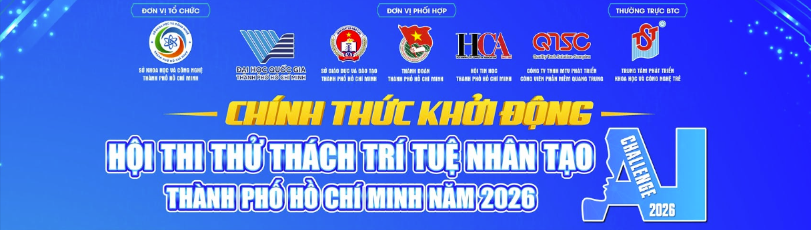
</p>

<h1 align="center">AIC2026 – Multimodal Video Retrieval & Verification System</h1>

<p align="center">
  <b>AI Challenge Thành phố Hồ Chí Minh 2026</b><br>
  Đội <b>SS009.Q24</b><br>
  <b>Score: 72.2 / 84</b>
</p>

---

## About the Competition

Đây là hệ thống **truy xuất và kiểm chứng video đa phương thức** được phát triển bởi đội **SS009.Q24** để tham gia **AI Challenge Thành phố Hồ Chí Minh 2026**.

Hệ thống hỗ trợ ba dạng tác vụ chính:

- **KIS – Known-Item Search**
- **VQA – Visual Question Answering**
- **TRAKE – Temporal Retrieval and Alignment of Key Events**

Trong quá trình thi, đội **SS009.Q24** đạt **72.2 / 84 điểm**.

Mục tiêu của hệ thống là hỗ trợ người dùng tìm nhanh video/frame phù hợp từ tập dữ liệu lớn, sau đó kiểm tra lại kết quả trên video gốc, timeline và canonical frame trước khi lựa chọn kết quả cuối cùng.

---

## System Overview

Hệ thống được thiết kế theo hướng **multimodal video retrieval kết hợp human-in-the-loop verification**. Thay vì phụ thuộc vào một mô hình duy nhất, hệ thống kết hợp nhiều tín hiệu gồm **Visual, OCR, ASR, Object và Metadata** để tăng khả năng truy xuất và kiểm chứng kết quả.

Một nguyên tắc quan trọng của hệ thống là mọi kết quả đều được ánh xạ về cùng một định danh:

```text
video_id + frame_id + timestamp_ms
```

nhằm đảm bảo retrieval, timeline và frame cuối cùng sử dụng chung một hệ quy chiếu.

<p align="center">
  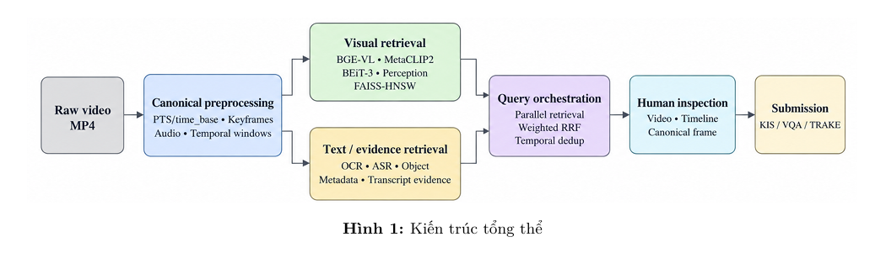
  <br>
  <em>Kiến trúc tổng thể của hệ thống.</em>
</p>

---

## Methodology

Pipeline tổng quát của hệ thống gồm bốn giai đoạn chính:

1. **Canonical preprocessing:** xử lý video gốc, trích xuất keyframe, audio và temporal mapping.
2. **Multimodal retrieval:** truy xuất bằng visual embedding kết hợp OCR, ASR, Object và Metadata.
3. **Rank fusion:** hợp nhất kết quả từ nhiều nhánh bằng Weighted Reciprocal Rank Fusion.
4. **Human verification:** người dùng kiểm tra video, timeline và canonical frame trước khi nộp kết quả.

### Visual Retrieval

Hệ thống sử dụng nhiều vision-language model để biểu diễn nội dung video dưới dạng embedding, gồm:

- **BGE-VL**
- **MetaCLIP2**
- **BEiT-3**
- **Perception Encoder**

Các embedding được lập chỉ mục bằng **FAISS-HNSW** để hỗ trợ truy xuất nhanh các frame có nội dung gần với query.

Tùy loại truy vấn và runtime configuration, hệ thống có thể lựa chọn các model phù hợp thay vì bắt buộc chạy toàn bộ model cùng lúc.

### Multimodal Evidence

Visual retrieval được bổ sung bằng các nguồn evidence:

- **OCR:** CRAFT + PARSeq-VN
- **ASR:** Chunkformer-CTC-Large-Vie + Silero VAD
- **Object Detection:** RF-DETR
- **Metadata:** thông tin hỗ trợ lọc và kiểm chứng candidate

Các nguồn evidence này giúp tăng khả năng phân biệt giữa những candidate có nội dung thị giác tương tự nhau.

### Rank Fusion

Các retrieval branch có thang điểm khác nhau nên hệ thống sử dụng **Weighted Reciprocal Rank Fusion (Weighted RRF)** để hợp nhất kết quả.

```text
Score(c) = Σ [ w_m × q_m(c) / (k + rank_m(c)) ]
```

Trong đó:

- `w_m`: trọng số của modality
- `q_m(c)`: độ tin cậy của candidate
- `rank_m(c)`: thứ hạng candidate trong modality tương ứng
- `k = 60`

Sau bước fusion, hệ thống thực hiện temporal deduplication trước khi trả danh sách candidate cho người dùng.

---

## Backend System

Backend được xây dựng bằng **FastAPI** và đóng vai trò điều phối truy vấn giữa frontend và các retrieval module.

Khi nhận query, backend xác định các nhánh cần sử dụng như **Visual, OCR, ASR, Object hoặc Metadata**, hợp nhất kết quả bằng **Weighted RRF**, thực hiện temporal deduplication và trả các candidate tốt nhất về giao diện.

Backend đồng thời giữ thống nhất thông tin `video_id`, `frame_id` và `timestamp_ms` để frontend có thể mở đúng video và frame tương ứng.

<p align="center">
  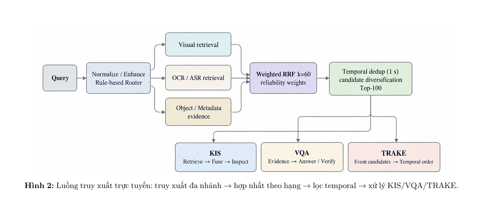
  <br>
  <em>Luồng truy xuất trực tuyến và xử lý KIS/VQA/TRAKE.</em>
</p>

---

## Task Processing

### KIS – Known-Item Search

KIS tập trung vào việc tìm đúng video hoặc frame dựa trên mô tả của người dùng.

```text
Query
  ↓
Multimodal Retrieval
  ↓
Rank Fusion
  ↓
Candidate Inspection
  ↓
Canonical Frame Selection
```

Sau retrieval, người dùng kiểm tra lại candidate trên video và timeline trước khi lựa chọn frame cuối cùng.

<table>
  <tr>
    <td align="center" width="50%">
      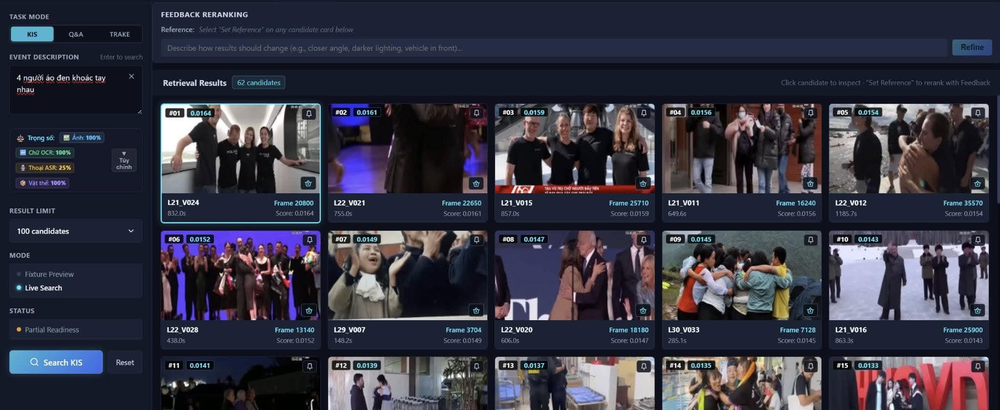
      <br>
      <em>Query & Retrieval Workspace</em>
    </td>
    <td align="center" width="50%">
      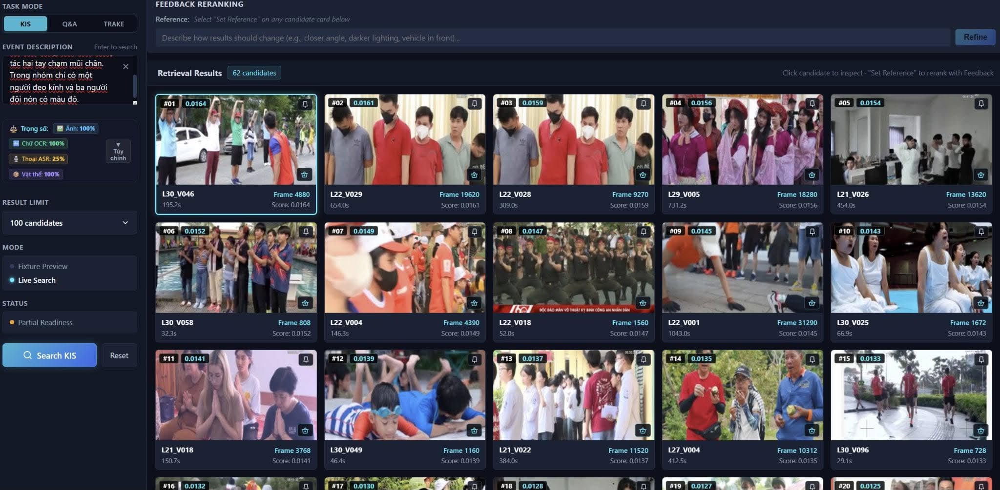
      <br>
      <em>Video & Frame Inspection Workspace</em>
    </td>
  </tr>
</table>

### VQA – Visual Question Answering

VQA không chỉ yêu cầu tìm đúng video mà còn cần xác định evidence liên quan đến câu hỏi và supporting frame tương ứng.

```text
Question
  ↓
Multimodal Evidence Retrieval
  ↓
Evidence Pack
  ↓
Answer Verification
  ↓
Supporting Canonical Frame
```

<p align="center">
  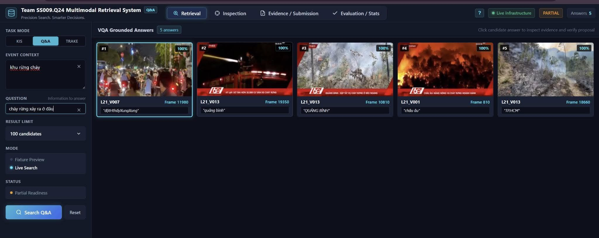
  <br>
  <em>Giao diện xử lý và kiểm chứng truy vấn VQA.</em>
</p>

### TRAKE – Temporal Retrieval and Alignment of Key Events

TRAKE xử lý truy vấn gồm nhiều sự kiện có thứ tự thời gian. Các candidate cần được kiểm tra để đảm bảo các event thuộc cùng video và xuất hiện đúng trình tự.

```text
Multi-event Query
  ↓
Event Decomposition
  ↓
Candidate Retrieval
  ↓
Temporal Sequence Matching
  ↓
Chronological Verification
```

<p align="center">
  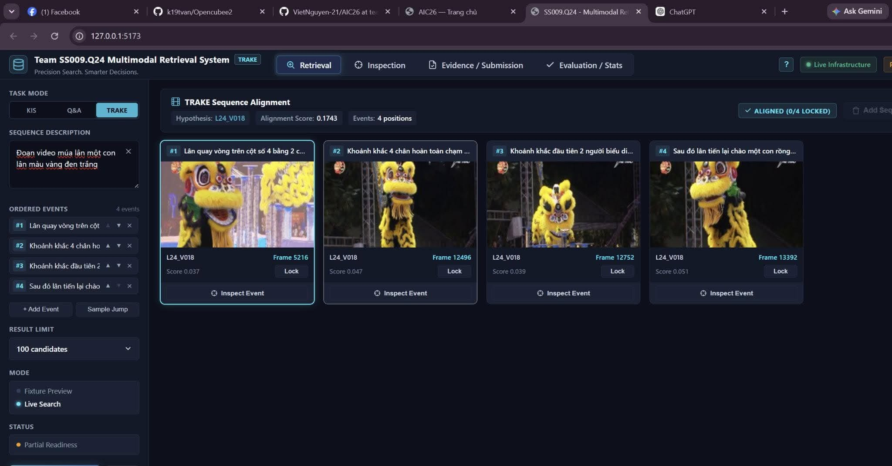
  <br>
  <em>Giao diện xử lý chuỗi sự kiện theo thời gian của TRAKE.</em>
</p>

---

## Human-in-the-loop Verification

Hệ thống áp dụng chiến lược:

> **Tăng recall ở tầng retrieval, giảm false positive ở tầng inspection.**

Candidate do hệ thống tìm được chưa được xem ngay là kết quả cuối cùng. Người dùng có thể tiếp tục kiểm tra bằng video gốc, timeline, neighboring keyframes, canonical frame và các evidence đa phương thức trước khi đưa kết quả vào submission.

---

## System Interface

Giao diện được xây dựng bằng **React + TypeScript** theo hướng một **inspection cockpit**, giúp người dùng thực hiện toàn bộ quy trình từ nhập truy vấn, xem candidate, kiểm tra video, quản lý evidence đến hậu kiểm kết quả trước khi nộp.

<table>
  <tr>
    <td align="center" width="50%">
      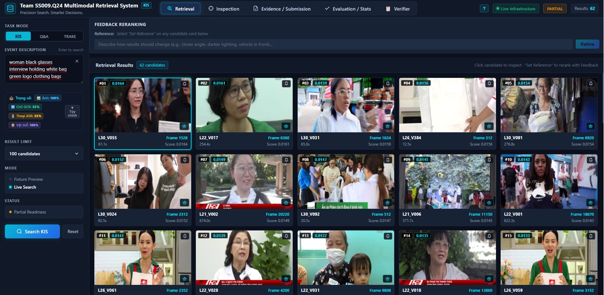
      <br>
      <b>Query & Retrieval Workspace</b><br>
      <sub>Nhập mô tả sự kiện, tùy chỉnh các tín hiệu retrieval và xem danh sách candidate.</sub>
    </td>
    <td align="center" width="50%">
      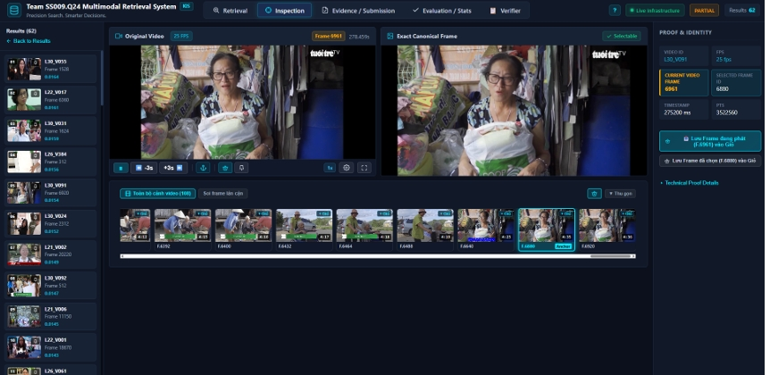
      <br>
      <b>Inspection Workspace</b><br>
      <sub>Đối soát video gốc, timeline, canonical frame và các keyframe lân cận.</sub>
    </td>
  </tr>
  <tr>
    <td align="center" width="50%">
      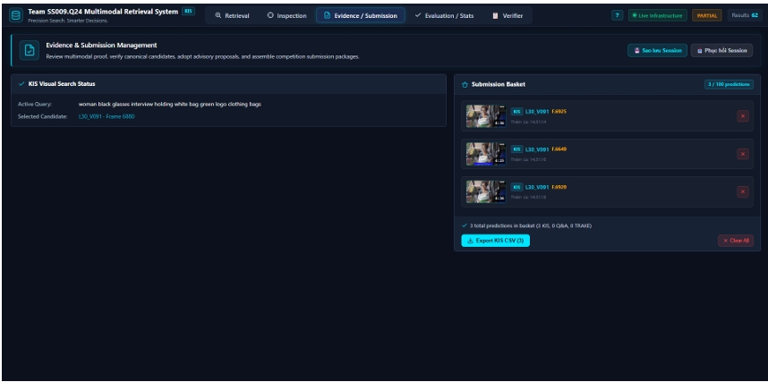
      <br>
      <b>Evidence & Submission Management</b><br>
      <sub>Quản lý evidence, lưu kết quả vào Submission Basket và theo dõi danh sách nộp.</sub>
    </td>
    <td align="center" width="50%">
      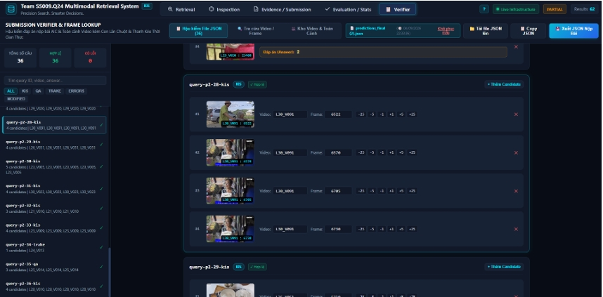
      <br>
      <b>Submission Verifier</b><br>
      <sub>Hậu kiểm kết quả KIS/VQA/TRAKE, vi chỉnh frame và chuẩn bị dữ liệu nộp.</sub>
    </td>
  </tr>
</table>


---

## Tech Stack

| Thành phần | Công nghệ / Mô hình |
|---|---|
| Backend | FastAPI |
| Frontend | React, TypeScript |
| Video Processing | PyAV |
| Vector Search | FAISS-HNSW |
| Visual Models | BGE-VL, MetaCLIP2, BEiT-3, Perception Encoder |
| OCR | CRAFT, PARSeq-VN |
| ASR | Chunkformer-CTC-Large-Vie, Silero VAD |
| Object Detection | RF-DETR |
| Data Storage | Apache Parquet |
| Rank Fusion | Weighted Reciprocal Rank Fusion |

---

## Installation & Setup

README này tập trung vào việc giới thiệu tổng quan hệ thống, phương pháp và giao diện.

Hướng dẫn chi tiết về cài đặt môi trường, dependency, dataset, model, preprocessing, build index, chạy backend/frontend và troubleshooting được đặt trong:

### ➡️ [SETUP.md](SETUP.md)

---

## Notes

Trong quá trình phát triển có nhiều module thử nghiệm và không phải tất cả đều được bật trong cùng một runtime configuration.

Khi tái lập hệ thống cần chú ý đến source code version, runtime configuration, model đang được kích hoạt và artifact/index tương ứng.

Với những candidate gần nhau về nội dung hoặc thời gian, bước kiểm tra thủ công trên video và canonical frame vẫn đóng vai trò quan trọng.

---

## Achievement

**AI Challenge Thành phố Hồ Chí Minh 2026**

- **Team:** SS009.Q24
- **Score:** **72.2 / 84**

---

## Team

**SS009.Q24**

AI Challenge Thành phố Hồ Chí Minh 2026
